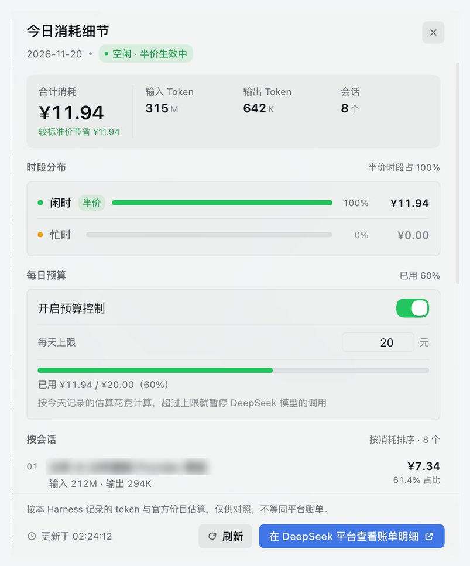
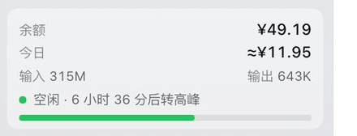

# 余额与用量（dsh-spend-meter）

> **每一轮对话花了多少钱，现在就看得见——超预算会自己踩刹车。**

DeepSeek Harness 插件：在侧栏底部常驻显示 **余额 / 今日消耗 / 今日输入输出 token / 闲忙时段**，点开是今日消耗明细，并可设 **每日预算**（超 90% 告警、到顶暂停 DeepSeek 模型调用）。

## 预览

**今日消耗细节**（汇总 / 时段分布 / 每日预算 / 按会话；会话标题已打码）：



**侧栏卡片**（开启预算后底部多一条进度条）：



## 安装

本地目录安装（开发中推荐）：

1. 把本仓库放到任意目录，例如 `~/.dsh/plugins-src/dsh-spend-meter`；
2. 打开 DSH → **插件** → **添加插件** → 选这个目录；
3. 或在 Agent 里让它执行 `plugin_manager` / `install_bundle`，目标就是这个目录。

插件本身没有 npm 依赖；要求 DSH 版本 ≥ `0.2.2-rc.3`（用到的 `webServer`、`shell.overlay`、`agent/pre-step` 都以该版本为准），界面语言中英双语。

## 侧栏卡片

侧栏底部（Settings 上方）常驻，不用点开：

- **余额**：当前登录的 DeepSeek 账号钱包（充值 + 赠送）。
- **今日**：今天本 Harness 各会话记录的 token 用量，按 DeepSeek 官方价目折成钱（`≈` 表示估算）。
- **输入 / 输出**：今天的 token 数分开显示（`1.2K / 18.6M` 缩写，精确值在悬停提示里）。
- **闲忙时**：此刻是高峰还是空闲（含价格含义），以及距离下次切换多久。

## 今日消耗细节

整块是按钮：点一下（或 Tab 聚焦后回车）打开弹窗：

- **汇总**：合计金额、输入 token、输出 token、会话数（token 精确值在悬停提示里）。
- **闲时 / 忙时**：两个时段各自的金额、占比条（高峰用警示色，空闲用成功色）。
- **按会话**：今天每个会话的标题、输入/输出 token、金额，按金额从高到低；超过 40 个只显示前 40 个并注明总数。
- **按模型**：今天用到多个模型时才出现。
- **底部**：口径说明、更新时间、「刷新」按钮，以及「在 DeepSeek 平台查看账单明细 →」（URL 取自账号服务的 `links.usageUrl`，默认 `https://platform.deepseek.com/usage`）。

弹窗挂在宿主的帧级浮层（`shell.overlay`）里，因为侧栏会裁切 overflow；面板用宿主菜单面板的 token（`--dsw-specific-menu`、`--dsw-radius-lg`、`--dsw-elevation-prominent`），遮罩是一层固定半透明黑。Esc、点遮罩、右上角 × 都能关闭。

宽栏是一张小卡片（半透明蒙层 + 圆角，不铺不透明底色，macOS 的侧栏 vibrancy 不会被破坏）：两行 key/value + 一行时段状态；侧栏收成 56px 窄栏时缩成 36px 宽的小方块（色点 + 余额 + 今日）。完整读数（余额拆分、缓存命中 / 未命中 / 输出 tokens、会话数、非 DeepSeek 调用条数）在鼠标悬停的原生 tooltip 里。

## 位置上的一个已知取舍

宿主的 `sidebar.footer.action`（Settings 上方那条）同时被内置的 Cordis 面板按钮使用，而那个按钮在**存在 Cordis 动态包时**会占满整行宽度。本条目按「可收缩」处理，不去抢它的宽度：所以正常情况（没有 Cordis 动态包）能看到，一旦跑过 Cordis 动态包就可能被挤没。`README` 与插件详情页都写明了这一点，没有偷偷改宿主布局。

## 每日预算（默认关闭）

弹窗里「时段分布」下方是「每日预算」：

- **开关**：默认关闭；打开后按「今天本 Harness 记录的估算花费」计。
- **每天上限**：默认 20 元，可改；输入框失焦或回车即保存。
- **90% 提示**：用到上限的 90% 起，弹窗与侧栏卡片都转成告警色并写明百分比；侧栏卡片还会多一条 5px 进度条（绿 → 琥珀 → 红）。
- **到顶拦截**：达到上限后，**DeepSeek 的模型请求会在进入模型前被拒掉**（只拦 provider 名里带 `deepseek` 的，其他 provider 照常），侧栏卡片显示「预算已用完」，弹窗写明原因和自动恢复时间（北京时间次日 0 点）。
- 上限金额按**当前账号的币种**计（人民币账号就是元）；换币种不会自动换算。
- 预算配置存在 `~/.dsh/spend-meter/budget.json`，跟 profile 的 patch 分开；写文件是临时文件 + rename 的原子写。

## 口径与限制

- 余额来自 DeepSeek 账号服务（`ctx.deepseekAccount`）。未登录显示「未登录」，不会去读 API Key 的余额。
- 今日消耗只算**本 Harness** 记录到的调用：在别处（网页、其他工具）用同一个 Key 产生的消耗不计入。
- 只折 **DeepSeek 模型** 的钱（provider 名字里带 `deepseek`）；别的 provider 只计次，tooltip 会标出条数。
- 高峰时段：北京时间**周一至周五 09:00–12:00、14:00–18:00**；其余时间与周末按空闲（半价）计。法定节假日**没有内置表**，需要时用下面的 `holidays` 配（未配时 tooltip 会明说）。
- 价目内置在 `index.js` 顶部的 `PRICES`，按 DeepSeek 官方「模型 & 价格」页（2026-11-18 版）抄的；官方调价后改这一处。
- 数据约每分钟刷新一次（页面隐藏时不刷新），切换时刻会立刻补一次；超过 3 分钟没取到新数据会把整条变暗并在 tooltip 里标「可能已过期」。
- 宿主进程里第一次请求时才扫描今天的会话日志，装完第一次可能稍慢；之后靠 `session/event` 增量记账，每 5 分钟兜底补扫，跨北京时间零点自动清账。

## 配置（可选）

在 profile 的 `cordis.patch.yml` 里给这条行加 config：

```yaml
- id: spend-meter
  name: dsh-spend-meter
  config:
    holidays: ['2026-10-01', '2026-10-02', '2026-10-03']
```

`holidays` 用北京时间日期（`YYYY-MM-DD`），列进去的日期按空闲时段计。

## 许可证

MIT，见 [LICENSE](LICENSE)。
